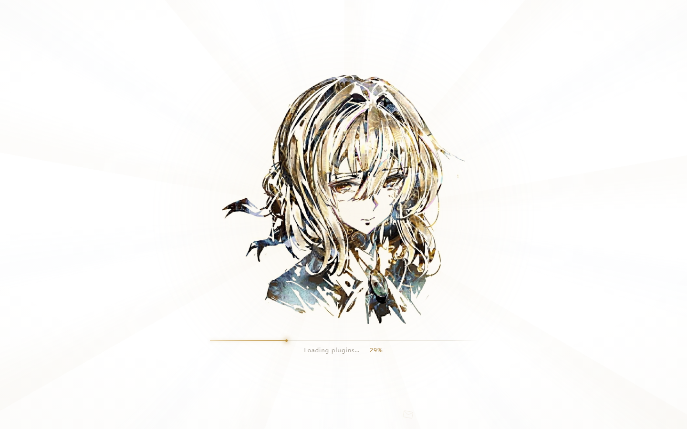
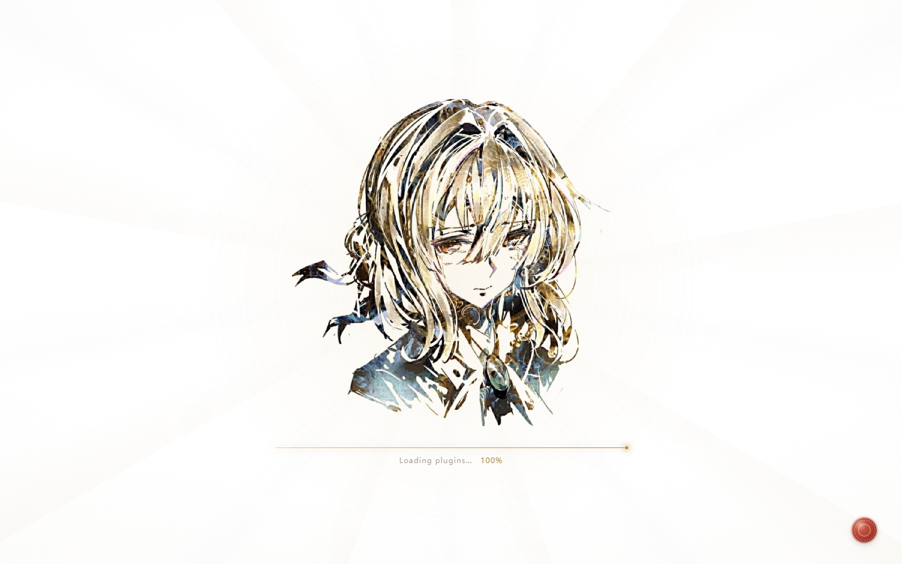

# dsh-violet-boot

给 **DeepSeek Harness** Web UI 的开机画面换一段《紫罗兰永恒花园》气质的动画：
**纯白画面上，薇尔莉特的画像居中，随加载从模糊中显影**（blur → 清晰、极轻微推近），
下方一条暖金细线随进度生长，画完在右下角落一枚火漆印，然后让位给应用。
画面上不放任何标题字样（干净整洁优先），只在底部保留一行真实的 `Loading plugins… NN%`。

- **一张随包的浅色水彩人像**（`assets/portrait.jpg`，以 base64 内联进注入的样式，
  运行时不需要任何外部图片请求），其余全部由 CSS 绘制；
  **零外部字体、零运行时依赖**（没有任何 `dependencies`）。
- **跟随真实进度**：动画读取原生开机遮罩上的 `--dsh-boot-arc`，不是假进度条。
- **一定收尾**：最短 2.5s（避免闪一下就走）＋最长 20s 兜底＋可点击/按键/滚轮跳过。
- **不碰官方安装包**：只用 `webserver/index-inject` 往 index.html 的 `<head>/<body>`
  注入一段 style 与 script，早于首帧生效；升级 DSH 不会失效，卸载即还原。

## 它会长什么样

| 进度 | 画面 |
| --- | --- |
| 0% | 近纯白的页面（实测 251–255），几乎看不见的光柱与浮尘，画像居中从模糊中显影 |
| 30%~70% | 画像完全清晰，底部暖金细线随进度生长，光点走在最前面 |
| >84% | 右下角盖上红色火漆印（**默认关**：`seal: true` 或 `?seal=1` 才有） |
| 收尾 | 进度拉满 → 横向光扫 → 淡出，把原生遮罩交还给你 |




想要旧版的「打字机敲出 HARNESS」画面，把 `wordmark` / `subtitle` 配上文案即可
（见下节配置表），或用仓库里的 `dsh-violet-boot-0.1.0.zip`。
想要 v0.2.0 那张「画像印在奶油色信笺上」的画面，用 `dsh-violet-boot-0.2.0.zip`。

画像的浅色底用的是 `mix-blend-mode: multiply`：照片底色已被预处理拉成纯白，
混合之后就等于背景色本身，因此看不出图片的方框。

正常加载、加载失败（会立刻让位，露出原生插件的失败列表）、插件全被缓存
（遮罩从未出现）三条路径都测过，都会在最短时长后干净退场。

## 界面背景图（v0.4.0 起）

同一个插件还负责给 **DSH 使用界面**铺一层薇尔莉特画像的底纹：默认把同一张水彩画
**去掉白底**后贴在画布右侧，靠左用一层渐浓的柔光罩压住，保证正文可读；
深色主题自动换成暗版画布。整体是「抬眼看见一点水彩，低头读字不受干扰」。

- 图片**不进 index.html**：走宿主路由 `/violet-boot/wallpaper.webp` 按需加载
  （带 `ETag` + `no-cache`，换了 `assets/wallpaper.webp` 刷新即生效），
  避免每次渲染都多传约 300KB base64。
- **只碰 DSH 的主题语义变量**（`--dsw-alias-bg-base` / `--dsw-alias-bg-layer-1`），
  **不用任何 hash 类名**——实测活页面里的类名（`.pI_x6G_frame`）与打包 CSS 里的
  （`._frame_1hfzl_1`）并不相同，依赖它们换版本必坏。
- 背景只画一层（`html body`），其余容器透明；若让每层各自半透明，透明度会**层层相乘**
  （0.9³≈0.73），画像透不出来、且层数一变效果就变。
- 柔光罩是**横向渐变**而非整片：文字都排在左侧、画像偏在右侧，整片压暗要么糊住文字、
  要么把画像压到看不见。
- 菜单 / 弹窗 / 对话框的底色**保持不透明**（读文字的地方不参与背景）。

| 键 | 默认 | 说明 |
| --- | --- | --- |
| `wallpaper` | `true` | 总开关；`false` 则完全不注入背景样式、也不注册路由 |
| `wallpaperSize` | `"auto 92%"` | `background-size`，只作用于画像那一层 |
| `wallpaperPosition` | `"72% 30%"` | 宽屏下画像位置（`x% y%`），默认偏右 |
| `wallpaperPositionNarrow` | `"58% 24%"` | `max-width: 900px` 时的位置，避免被侧栏压住脸 |
| `wallpaperScrim` | `88` | 浅色主题右侧柔光罩浓度（0–100，越大越淡） |
| `wallpaperScrimFalloff` | `8` | 左边缘比右侧再浓多少（形成「左浓右淡」的渐变） |
| `wallpaperScrimDark` | `90` | 深色主题的柔光罩浓度 |
| `wallpaperSidebar` | `72` | 侧栏面板的遮盖度（0=全透明、100=完全不透） |

对应环境变量：`VIOLET_BOOT_WALLPAPER` / `VIOLET_BOOT_WALLPAPER_SCRIM` /
`VIOLET_BOOT_WALLPAPER_SCRIM_DARK`。

关掉背景图有三种方式，效果完全一致（回到 DSH 原生外观，零痕迹）：

```yaml
# cordis.patch.yml
config:
  wallpaper: false
```

```bash
# 环境变量
VIOLET_BOOT_WALLPAPER=0 dsh ...
```

```js
// 运行时（浏览器控制台）
document.documentElement.classList.add("ve-no-wallpaper");
```

想换一张背景：替换 `assets/wallpaper.webp` 即可（刷新生效，无需重启）。
建议是**去掉背景的透明 WebP**——用仓库里的 `tools/make-wallpaper.py` 从原图生成：
它从四边做泛洪填充、只删与边缘连通的纸底，因此被笔触围住的**脸部白会被保留**
（直接按亮度抠图会把脸抠成空心面具）。

## 安装

### 桌面版（Electron，profile 名是 `desktop`）

`desktop` 这个 profile **由 Electron 应用独占管理**，命令行直接拒绝：

```
$ dsh plugin --profile desktop add <路径>
error: profile "desktop" is managed exclusively by the Electron application
```

所以桌面版要走应用自带的**插件页**：

1. 左侧边栏 → **插件** → **添加插件**
2. 输入框里粘贴**本目录的绝对路径**（该框接受包名 / GitHub 仓库地址 / 本地目录路径）
3. 点 **安装** —— 它会在 `desktop` profile 里跑一次 pnpm（本包会被以 `link:` 形式引入）
   并把 `dsh-violet-boot` 加进 `dsh.profile.bundles`
4. **重启 DSH 桌面应用**（desktop profile 没有 `"patchReload": "live"`，装完不会热更）

卸载：同一页面里卸载，或删掉 profile 的 `package.json` 里那条依赖。

### 其他 profile（web / tui / 自建），命令行一条命令

```bash
dsh plugin --profile <profile> add <本目录的绝对路径>
```

也可以从 npm 装（把本包发布后）：`dsh plugin --profile <profile> add dsh-violet-boot`。
装完同样**需要重启**。

## 配置

默认值都写在 `lib/index.js` 的 `DEFAULT_CONFIG` 里。要改，就编辑 profile 目录下的
`cordis.patch.yml`（Desktop 版是 `%USERPROFILE%\.dsh\profiles\<profile>\cordis.patch.yml`），
把这一层补成带 `config` 的形式：

```yaml
- insert:
    - id: violet-boot
      name: dsh-violet-boot
      config:
        minDurationMs: 2500
        maxDurationMs: 20000
        outroMs: 760
        skippable: true
        wordmark: ""          # 留空 = 画面上不出现字样
        subtitle: ""          # 留空 = 不显示副标题
        hint: Loading plugins…
        typedCharMs: 135
        letters: 12
        motes: 26
        seal: false
        portrait: ""
        wallpaper: true
        wallpaperScrim: 88
        wallpaperScrimDark: 90
        wallpaperSidebar: 72
```

| 键 | 默认 | 说明 |
| --- | --- | --- |
| `minDurationMs` | `2500` | 最短播放时长；加载再快也不闪一下就走 |
| `maxDurationMs` | `20000` | 兜底上限；任何情况下都不会永久遮挡界面 |
| `outroMs` | `760` | 收尾淡出时长 |
| `sweepMs` | `700` | 收尾光扫时长 |
| `skippable` | `true` | 允许点击 / 按键 / 滚轮跳过 |
| `wordmark` | `""`（不显示） | 被逐字敲出来的字样；填 `HARNESS` 之类就会在画像下方逐字敲出 |
| `subtitle` | `""`（不显示） | 画像下方的副标题，例如 `自动手记人形 · AUTO MEMORY DOLL` |
| `hint` | `Loading plugins…` | 进度行文案 |
| `typedCharMs` | `135` | 每个字的打字间隔 |
| `letters` | `12` | 背景飘散的信件数量 |
| `motes` | `26` | 背景尘埃数量 |
| `seal` | `false`（不显示） | 进度过 84% 时在右下角落一枚火漆印；设 `true` 就有它（`?seal=1` 可在预览里试） |
| `portrait` | `""` | 换一张主题画像：填图片 URL / `data:` URI；留空则用随包的 `assets/portrait.jpg`（写成 `data:` URI 时别含引号、括号、空白或反斜杠） |
| `wallpaper` | `true` | 界面背景图总开关（详见上一节） |
| `wallpaperSize` | `"auto 92%"` | 背景图 `background-size` |
| `wallpaperPosition` | `"72% 30%"` | 宽屏下背景图位置 |
| `wallpaperPositionNarrow` | `"58% 24%"` | `max-width: 900px` 时背景图位置 |
| `wallpaperScrim` | `88` | 浅色主题柔光罩浓度（0–100） |
| `wallpaperScrimFalloff` | `8` | 左侧比右侧额外加浓多少 |
| `wallpaperScrimDark` | `90` | 深色主题柔光罩浓度 |
| `wallpaperSidebar` | `72` | 侧栏面板遮盖度（0–100） |

不改 profile 也能临时调（环境变量优先级最高，便于试参数）：

```
VIOLET_BOOT_MIN_MS / VIOLET_BOOT_MAX_MS / VIOLET_BOOT_OUTRO_MS
VIOLET_BOOT_SKIPPABLE / VIOLET_BOOT_WORDMARK / VIOLET_BOOT_SUBTITLE / VIOLET_BOOT_HINT
VIOLET_BOOT_PORTRAIT / VIOLET_BOOT_SEAL
VIOLET_BOOT_WALLPAPER / VIOLET_BOOT_WALLPAPER_SCRIM / VIOLET_BOOT_WALLPAPER_SCRIM_DARK
```

改完 `lib/boot.css` / `lib/boot.js` / `lib/wallpaper.css` **不用重启**，刷新页面即可——
插件每次渲染 index 都重新读盘；背景图路由也是每次请求重读 `assets/wallpaper.webp`。

## 为什么是宿主插件，而不是客户端插件

DSH 的开机画面（`.boot` 遮罩 + `--dsh-boot-arc` 环形进度）出现在**客户端插件加载之前**、
销毁于应用挂载之后。也就是说：任何客户端插件跑起来时，开机画面已经结束了，永远来不及
接管它。唯一能在首帧之前动手的位置，是**服务端渲染 index.html 时**——也就是
`dsh-host-webserver` 的 `webserver/index-inject` 事件。本插件就订在那里。

## 与 DSH 的耦合面（刻意收窄）

- 只依赖两个稳定的自定义属性：`[data-dsh-boot]` 与 `[data-dsh-boot-spinner]`（以及
  后者的 `--dsh-boot-arc`）。**不使用**任何被 hash 过的类名（`._boot_u7vgf_3` 之类），
  那些会随打包变。
- 遮罩消失 = 插件加载完；`textContent` 含 `Failed to load` = 加载失败。
- 万一将来这两个信号都变了，还有两条兜底：`#root` 出现子节点即为应用已挂载；
  以及不看任何信号、到 `maxDurationMs` 无条件收尾。
- 动画的推进与淡入都不只依赖 `requestAnimationFrame`：主循环另有 120ms 的
  `setInterval` 滴答，淡入除了 rAF 还有 60ms 定时器兜底（窗口隐藏/后台时 rAF 会停摆，
  只挂 rAF 会让遮罩永远停在 opacity 0 = 用户看到一片白）。
- 结束时会给自己 html 加 `.ve-release`，样式层立刻回到“不干预”，原生遮罩（含失败
  列表）原样交还。

## 目录

```
lib/index.js          宿主插件：订阅 webserver/index-inject、组装注入行、注册背景图路由
lib/boot.css          动画样式层（白色舞台、画像显影与混合、光柱、进度光线、火漆印）
lib/boot.js           行为层（画像显影、进度跟随、收尾、兜底；配了 wordmark 才有打字）
lib/wallpaper.css     界面背景图样式层（画像 + 横向柔光罩 + 明暗双主题 + 侧栏遮盖）
assets/portrait.jpg   主题画像（预处理成纯白底，与白舞台 multiply 混合）
assets/wallpaper.webp 界面背景图（同一张画的「去白底」透明 WebP，约 230KB）
dsh.bundle.patch.yml  bundle 层：把插件的 id/name 插进 profile 的插件树
```

`lib/index.js` 导出的 `buildRows()` 是纯函数，离线预览工具直接复用它，
所以“预览里看到的”和“DSH 里跑到的”是同一份注入行。

**两个必须遵守的导出约定**（都踩过坑）：

1. **不要写 `export default`**。`cordis-plugin-loader` 的 `unwrapExports()` 会做
   `exports = exports.default ?? exports`，一旦有 default 导出，模块命名空间就被换成
   那个裸函数，`export const inject` 声明的服务依赖会被整个丢掉，报
   `cannot get property "webServer" without inject`。官方 `dsh-client-hmr` 同样只用具名导出。
2. **声明 `export const inject = ["webServer"]`**。少了它，`apply()` 可能早于 WebServer
   挂载，`ctx.get("webServer")` 拿到 `undefined` —— 症状是 index 注入正常、
   但背景图路由间歇性 404（取决于插件加载顺序）。

## 许可与素材

代码 MIT。主题画像 `assets/portrait.jpg` 与界面背景图 `assets/wallpaper.webp`
（由前者经 `tools/make-wallpaper.py` 去白底生成）由使用者本人提供（在他本地的开发目录里
经裁切、拉白、抠底、压缩后落到这两个路径），随包分发时请自行确认它们的使用与再分发权利——
**本仓库不对这些图片主张任何权利**；想换成自己的图，直接替换 `assets/portrait.jpg`
与 `assets/wallpaper.webp` 即可（画像保持接近正方形的构图、纯白底色，混合效果最好；
分辨率 760px 上下就够）。
除此以外，画面全部由代码绘制：没有使用任何《紫罗兰永恒花园》的字体或音频素材，
只有配色与意象（白纸、画像、火漆印、自动手记人形）是致敬。
